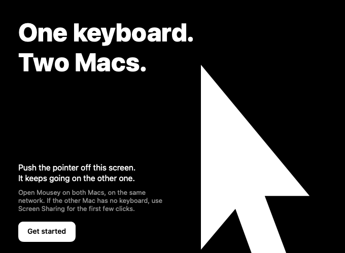
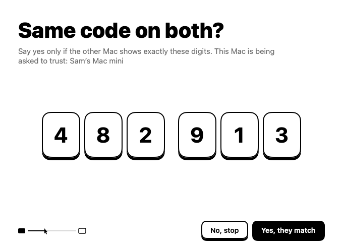

# Mousey

Use one Mac's keyboard and trackpad on a second Mac. Push the pointer through a screen edge, and your input moves to the other Mac over your own network, encrypted. There is no account and no server.



## Choose it when your Macs use different Apple Accounts

Apple's [Universal Control](https://support.apple.com/102459) does this job for free, but it needs the same Apple Account on both Macs. Mousey is for Macs that can't share an account, such as a work Mac and a personal Mac. If your Macs share an account, try Universal Control first.

| | Mousey | Universal Control |
| --- | --- | --- |
| Apple Account | Can differ on each Mac | Must be the same |
| Devices | 2 Macs | Up to 3 Macs or iPads |
| Direction | One Mac controls the other | Any of them can control the others |
| Clipboard | Text, links, and images, if you turn it on | Yes |
| Dragging files across | No | Yes |
| Price | Free | Free |
| Source code | Public | Closed |

Mousey is new. It has run on one Mac mini and one MacBook Air, both on macOS 26.5.1. The app allows macOS 12 and later, but no older version has been tested.

## Install it on both Macs

1. Download `Mousey.dmg` from the [latest release](https://github.com/IMsumitkumar/mousey/releases/latest).
2. Open the disk image and drag **Mousey** to **Applications**.
3. Open Mousey. macOS says it cannot verify the developer, because this build has no paid Apple signature. Click **Done**.
4. Open **System Settings**, then **Privacy & Security**.
5. Click **Open Anyway** next to Mousey, and enter your password.
6. Follow the tutorial on each Mac.

The tutorial asks for Accessibility, so the app can read and send keyboard and pointer events. It also asks for local network access, so the two Macs can find each other. To pair, you compare a 6-digit code on both screens. The tutorial then has you really cross to the other Mac and back.



To get back to the keyboard Mac at any time, hold Control, Option, and Command, and press Esc.

If the Macs can't find each other, check that they are on the same network. Guest networks often keep devices apart. You can also type the address that the other Mac shows while pairing.

## Stop the pointer stuttering on Wi-Fi

Macs pause Wi-Fi about twice a second for AirDrop and Handoff, through a radio mode called AWDL. A browser hides those pauses, but a pointer shows them. On the Mac mini tested, each pause lasted about 90 ms and came every 524 ms. Two 20-second runs against the router showed 36 and 37 stalls with AWDL on, and none with it off.

To remove the stutter, turn on **Smooth Wi-Fi** in Settings on both Macs. Mousey then turns AWDL off while you work across Macs and turns it on again 30 seconds after you stop. AirDrop stops working during that time, and so can other features that use AWDL, such as Handoff, wireless Sidecar, and peer-to-peer AirPlay. The switch asks for your password once, because it installs a small helper that runs as root. Ethernet also avoids the stutter, with no helper.

## Know what the app can see and send

While input stays on this Mac, Mousey watches pointer movement only, to notice a push through the edge. It does not see your keys.

While you control the other Mac, Mousey reads all your keyboard and trackpad input and sends it to the Mac you paired with.

The app makes only these connections:

| Connection | When | What it carries |
| --- | --- | --- |
| UDP port 47800, to the paired Mac | Once paired | Your input, encrypted with DTLS |
| TCP port 47801, to the other Mac | Only during pairing | Public keys and Mac names, for the code comparison |
| TCP port 47802, to the paired Mac | Only with **Share clipboard** on | Clipboard items, encrypted with TLS |
| Bonjour, on the local network | Once paired or pairing | Service announcements, so the Macs can find each other |
| HTTPS, to `api.github.com` | Once a day, unless you turn it off | A request for the latest version number |

The controlled Mac listens on every network interface, which can include a VPN. Only the paired key gets past the handshake, and pairing needs a person to say yes.

The first version check runs when the app first opens, before you see any window. To prevent it, run `defaults write io.github.imsumitkumar.mousey checkForUpdates -bool false` before you open the app. After that, the switch is in Settings.

There is no account and no analytics, and the project runs no server. The log at `~/Library/Logs/Mousey/app.log` records when things connect, and never what you type.

Most of this code was written with Claude Code, an AI tool, and reviewed by other AI reviewers. Nobody outside the project has audited it. [SECURITY.md](SECURITY.md) says what protects you, what doesn't, and how to report a problem.

## Update both Macs

When a new version is out, a dot appears on the menu bar icon and the menu offers the version. Choosing it opens the release page in your browser. Mousey never downloads or installs anything by itself.

Update the controlled Mac first, because quitting Mousey there ends your only input to it. If that Mac has no keyboard, turn on Screen Sharing or attach a keyboard before you quit.

To update, quit Mousey, replace it in **Applications**, and open it again. macOS asks for **Open Anyway** again for each download. Your permissions and your pairing stay. If macOS asks for Accessibility again after an update, stop, because that download may not be signed by this project.

A new version of the helper reaches you only when you turn **Smooth Wi-Fi** off and on again. The release notes say when that is needed.

## Known limits

- A key held down when control returns keeps repeating on the keyboard Mac.
- Scroll momentum can carry across a crossing.
- It supports two Macs, in one direction, and no Windows or Linux.
- Files don't move between Macs.
- Builds are self-signed and not notarized, because the project has no paid Apple account yet.
- It uses a private macOS call to hide the cursor, and it replays macOS's own event bytes, so a future macOS can break either one.

## Remove it

To remove everything from a Mac, first turn off **Smooth Wi-Fi** in Settings if you turned it on. If you already deleted the app, remove the helper with this command instead:

```bash
sudo /Library/PrivilegedHelperTools/io.github.imsumitkumar.mousey.awdl-helper --uninstall
```

Then run these commands:

```bash
pkill -x Mousey
```

```bash
tccutil reset Accessibility io.github.imsumitkumar.mousey
```

```bash
security delete-generic-password -s io.github.imsumitkumar.mousey.link
```

```bash
defaults delete io.github.imsumitkumar.mousey
```

```bash
rm -rf "/Applications/Mousey.app" ~/Library/Logs/Mousey
```

## Build it from source

You need Xcode. The project has been built with Xcode's Swift 6.3 only.

```bash
git clone https://github.com/IMsumitkumar/mousey.git
```

```bash
cd mousey
```

```bash
swift test
```

```bash
scripts/build-app.sh
```

The build writes the app to `dist/`. The first build makes a self-signed certificate in `.signing/`, so macOS keeps the app's permissions across your own rebuilds. Keep `.signing/` private. `scripts/verify.sh` runs the tests, builds the app, and runs the end-to-end self-test, with no extra permission and on loopback only.

[docs/DESIGN.md](docs/DESIGN.md) explains how the app works and why.

## Report a problem

Open an issue for a bug. Report a security problem privately, as [SECURITY.md](SECURITY.md) describes. One person maintains this project, so replies can be slow.

## License

Mousey is free software under the [GNU General Public License, version 3](LICENSE), with no warranty. Copyright 2026 IMsumitkumar.
